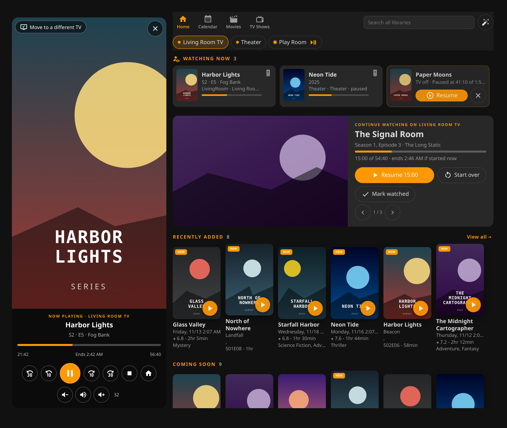
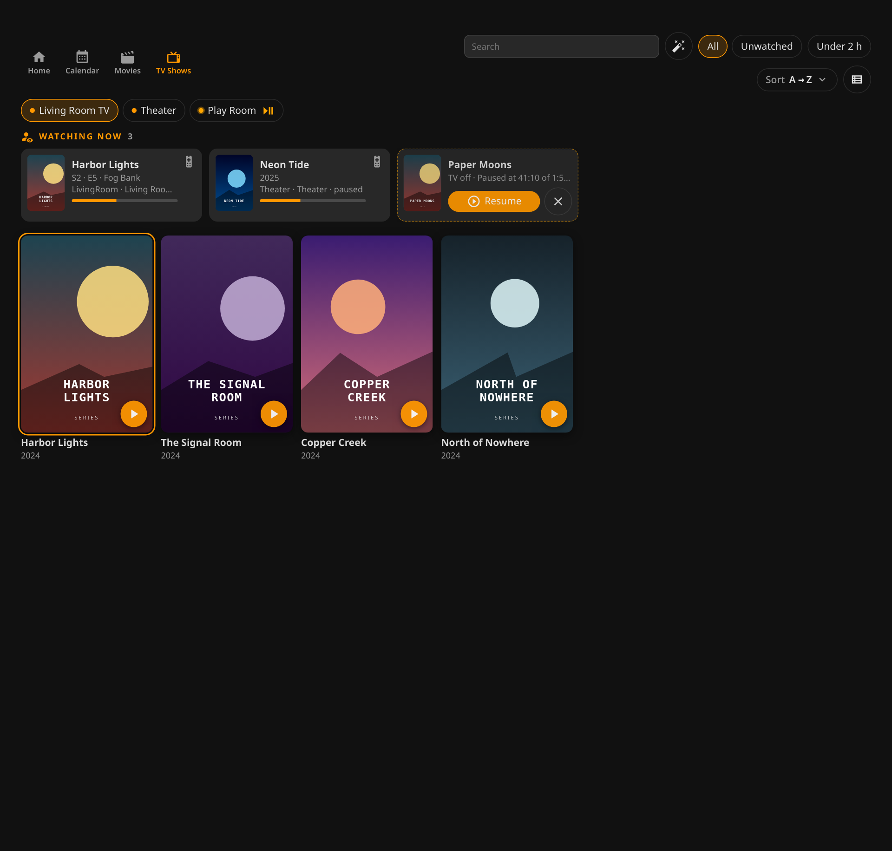
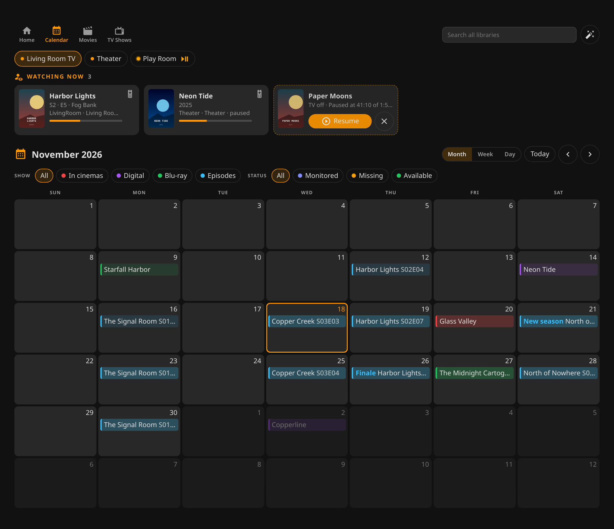
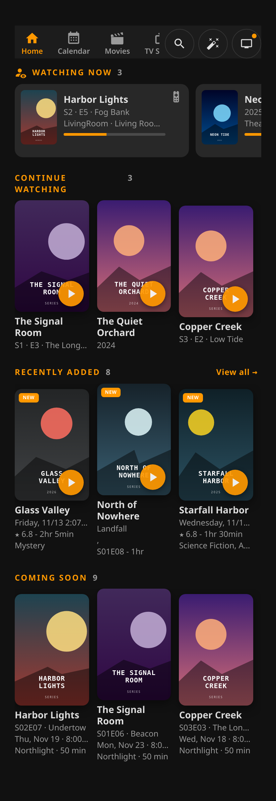
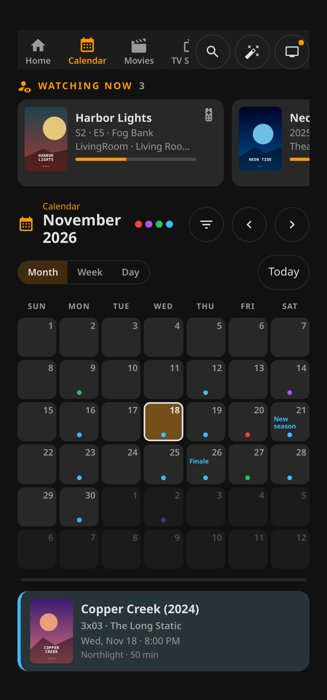
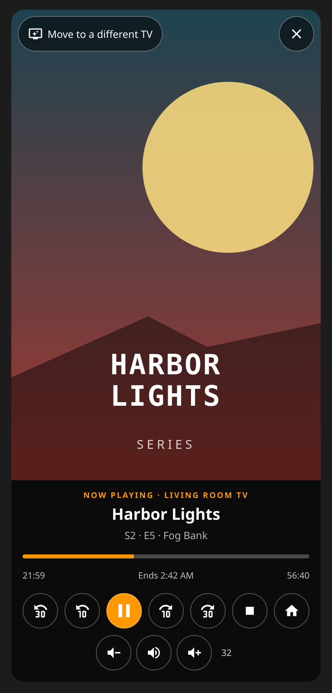

# Plex Center (Ltek)

<picture>
  <source media="(prefers-color-scheme: dark)" srcset="custom_components/plex_center/brand/dark_logo.png">
  
</picture>

Browse your Plex library on a Home Assistant dashboard and play on your TVs, the way you would with the remote.
Each TV shows the libraries, Continue Watching and watched marks of the Plex Home user its Plex app uses.

[](https://my.home-assistant.io/redirect/hacs_repository/?owner=Ltek&repository=plex-center&category=integration)

One integration, with its Dashboard card included: no login, no tokens in the browser.

## Screenshots

The titles and artwork below are made up for the screenshots.

**Home on a tablet:** Watching now (including a TV that's off with a show to resume), Continue watching, Recently
Added and Coming Soon, with the Now playing panel.



**A show's details:** Play on, Trailer, Mark watched, and its seasons and episodes.



**Calendar** from Sonarr and Radarr: episodes and movie releases (in cinemas, digital, Blu-ray).



**On a phone:** Home, the Calendar, and Now playing.

<p>
  
  
  
</p>

## What you need

| Part | Used for |
|---|---|
| **[Plex](https://www.home-assistant.io/integrations/plex/)** integration | the Plex server (Plex Center uses its connection) |
| **[PiPup](https://github.com/mhoogenbosch/PiPup)** app 0.32+ on the TV, with **[ha-pipup](https://github.com/mhoogenbosch/ha-pipup)** 1.32+ | playing on Android / Google TVs, pause, seek, Stop, Home (recommended) |
| or the **[Android TV (ADB)](https://www.home-assistant.io/integrations/androidtv/)** integration | the same without PiPup (no exact seek) |
| optional: **[Android TV Remote](https://www.home-assistant.io/integrations/androidtv_remote/)** integration | the TV's power state, and turning it on and off (found automatically) |
| optional: **[Google Cast](https://www.home-assistant.io/integrations/cast/)** integration | what other apps play, when PiPup and ADB don't say (found automatically) |
| optional: Plex Web / Plex HTPC | played on directly through Plex's own remote control |
| optional: **upcoming-media sensors** (Radarr / Sonarr) | the *Coming Soon* sections, found automatically |
| optional: **[Sonarr](https://www.home-assistant.io/integrations/sonarr/)** / **[Radarr](https://www.home-assistant.io/integrations/radarr/)** integrations | the **Calendar** page (upcoming episodes; movies in cinemas, digital, Blu-ray). Plex Center reuses their address and API key; the key stays in Home Assistant |

**PiPup setup:** on each TV, turn on media session access and allow clicks in Plex (ha-pipup's gear icon →
*Advanced install*, or `install.sh --media --click com.plexapp.android <tv-ip>`).

**Plex Home users:** give each TV's Plex app its own managed user **without a PIN** (LivingRoom, PlayRoom, …).
Plex Center opens the server as that user, so each room has its own Continue Watching and watched marks. A TV
signed in as the owner uses the owner's view.

## Set up

1. Install **Plex Center** from HACS (category *Integration*) and restart Home Assistant.
2. **Settings → Devices & services → Add integration → Plex Center.** Pick your Plex server if you have several.
   Your TVs are found automatically.
3. Check them under **Plex Center → Configure**: each TV's Plex Home user and players. *Find new TVs* adds ones
   set up later.
4. Add the card to a dashboard:

```yaml
type: custom:plex-center-card
```

Everything else is in the card's editor: which TVs it offers, the TV picker (buttons, dropdown or hidden),
libraries, Home rows, the Calendar, now-playing views (Watching now, side panel), screens, controls layout and look.

## Actions

```yaml
action: plex_center.play
data:
  tv: Living Room TV
  title: Bill & Ted's Excellent Adventure   # or key: "720622"
  mode: play                                # play (resume) | restart | next (next episode of a show)
```

```yaml
action: plex_center.control
data:
  tv: Living Room TV
  action: pause        # play | pause | play_pause | stop | home | seek | skip | volume_up | volume_down | mute | power_on | power_off
  value: -10           # seconds, for seek / skip
```

```yaml
action: plex_center.play_trailer
data:
  tv: Living Room TV
  key: "720622"        # a Plex title's own trailer, played in Plex; or url: a YouTube link, played in the TV's YouTube app
```

```yaml
action: plex_center.resume
data:
  tv: Living Room TV   # turn the TV on and carry on with what was playing when it was turned off
```

```yaml
action: plex_center.mark
data:
  tv: Living Room TV
  key: "720622"
  watched: true        # for the TV's Plex user
```

```yaml
action: plex_center.search          # returns the results: use response_variable
data:
  query: Ratatouille
  tv: Theater                       # optional: search as this TV's Plex user (their libraries, watched state)
  type: any                         # any | movie | show | episode
  limit: 10
response_variable: found            # found.results: [{key, type, title, year, watched, show, season, episode, library, ...}]
```

## Intros and credits

Plex Center reads Plex's intro and credits markers for what plays on each TV (once per title). Now playing shows
**Skip intro** during an intro, and **Skip credits** during credits that come before the end. Up next shows from the
start of the final credits.

When the final credits start, Home Assistant gets a `plex_center_credits_started` event (`tv`, `tv_name`, `key`,
`title`, `show`, `user`, `credits_start`, `credits_end`), and the TV's **At the credits** scene or script runs, if set
(TV settings in the card editor). It fires when playback reaches the credits, not when a title is resumed inside them.

```yaml
triggers:
  - trigger: event
    event_type: plex_center_credits_started
    event_data:
      tv: theater
actions:
  - action: scene.turn_on
    target:
      entity_id: scene.theater_lights_up
```

## Easy AV Control (power the room on and off)

With [Easy AV Control (Ltek)](https://github.com/Ltek/easy-av-control) installed, Plex Center finds each TV's room by
itself: the room with an activity that uses one of the TV's players (PiPup, ADB, Android TV Remote, Cast or Plex), else
a room in the TV's area. TV settings → *Easy AV Control → Room* shows what it found, and can pick another room or none.

- **Activity button** (Controls layout; next to the TV picker by default): **hold 3 s** to power on. With one activity
  that uses the TV it starts; with several, their menu opens and a tap starts one. While the room is on, **hold 5 s** to
  power it off, or tap to see it. Both times are in Global defaults (0 = a tap, then confirm). Only the activities that
  use the TV are offered.
- **The room's flow in the Now playing area** while it starts, turns off or fails: the step, what it's doing (warming
  up the projector, 42 s), every device's state, warnings, and on failure the error with Retry and Turn off. The
  library stays usable next to it; once the room is on (or something plays) Now playing takes over. On phones a slim
  bar shows it; tap it for the full flow. Started from a wall switch or an automation, it shows the same.
- **Play when ready**: Play on a title while the room is off turns it on first (asking which activity when several use
  the TV), shows *Then playing …* with **Cancel** in the flow, and plays once the room is on. If the room fails, the
  flow shows the error and **Retry and play**. Works for `plex_center.play` from automations too (`activity:` picks
  one, `start_room: false` skips it). Switch it off per TV in TV settings; a TV with its own Room power / status
  entities keeps using those.

## Rooms with several devices (a theater)

A TV can have a **Room power** entity and a **Room status** entity (in the TV's settings). Plex Center doesn't
know your devices: your own automation or script turns them on and off and checks them.

- **Room power**: an `input_boolean`, `input_select`, `select`, `switch`, `script` or `scene` your automation
  watches. For a select, set its on value (for example `Movie`) and off value.
- **Room status**: an entity that shows when everything is ready, for example a template binary sensor that is on
  only when every device is. Set its ready value if it isn't `on`.
- **Play, Resume and Turn on:** if the status isn't ready, Plex Center sets the power entity on, waits for the
  status to show ready (120 s by default), then wakes the TV and plays. If the room isn't ready in time, it says so
  and doesn't play. Without a status entity, it sets the power entity on and goes on.
- **Turn off** sets the power entity off, then puts the TV in standby.
- While the status shows its **starting** value (default `starting`), Plex Center waits without setting the power
  entity again; on its **failure** value (default `error`) it stops waiting and shows the room's `error`
  attribute. The card shows the room's progress while it starts.
- **The room turns the TV off** (option): Turn off only sets the power entity off.
- While the status shows ready, the TV counts as on.

With [AV Scenes](https://github.com/mkshb/hass-av-scenes): Room power = the room's **Select**, on value = the
activity's name (for example `Movie`), off value = `idle`; Room status = the room's **Sensor**, ready value
`active` (starting and failure values are AV Scenes' defaults).

```yaml
template:
  - binary_sensor:
      - name: Theater ready
        state: >
          {{ is_state('media_player.theater_shield', 'on') and is_state('media_player.jvc_projector', 'on') }}
```

## Notes

- **Other apps** (HBO Max, Prime Video …) show their poster when Plex Center can find the title, else the TV's
  screen capture (PiPup's when it works, else ADB's), else the app's logo or its name. Protected video (Prime
  Video) comes out black in a capture. Your own logos, by app id or name:

  ```yaml
  app_logos:
    Prime Video: /local/logos/prime-video.png
    com.disney.disneyplus: /local/logos/disney.png
  ```

- **Stop** sends Back, which leaves the Plex player for the title's page (the new Plex app ignores the Stop key).
- Plex plays a 30-second preview on a title's page; Plex Center doesn't treat it as playback.
- Works with the new Plex app for Android TV (2026), which no longer accepts remote control from Home Assistant.
- **Turning a TV off** uses ADB's sleep key or the Android TV Remote's Power key only, the same standby as the
  TV's remote, so Home Assistant can wake it again. A TV with neither has no Turn off in Plex Center (PiPup's turn
  off is a deep sleep on TCL Google TVs that only the remote wakes from).
- **When a TV is turned off** its apps are closed, but Plex keeps reporting the paused session. Plex Center reads
  the TV's power from the TV itself, remembers what was playing, and offers **Resume** (Watching now, Now playing
  and `plex_center.resume`): it turns the TV on, closes the screensaver and starts the title at Plex's saved
  position.

## Credits

The card's Home-row look and `$keyword` lines are adapted from
[upcoming-media-card](https://github.com/custom-cards/upcoming-media-card) (MIT). The Plex link formats and button IDs
were found by [Zaywest/ha-plex-shield-control](https://github.com/Zaywest/ha-plex-shield-control).

See [CHANGELOG.md](CHANGELOG.md) for what changed in each version.
